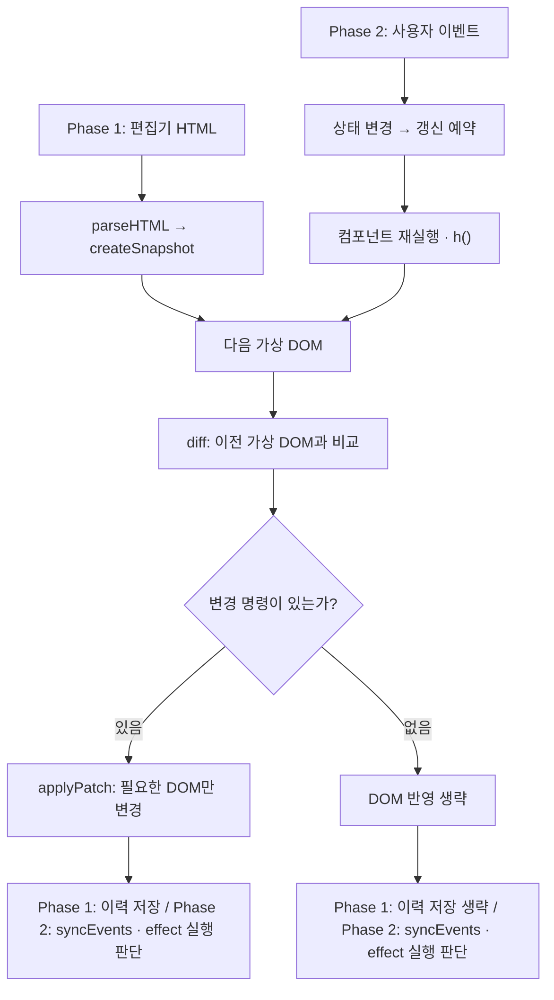

# Mini React

> 상태가 바뀌면 컴포넌트를 다시 실행하고, 이전·다음 가상 DOM을 비교해 필요한 부분만 실제 DOM에 반영하는 미니 리액트입니다.

## 1. 웹사이트 개발자가 겪는 문제

**React 같은 화면 갱신 도구 없이 웹사이트를 개발하면, 데이터와 DOM 사이의 갱신 관계를 개발자가 직접 관리해야 합니다.**

예를 들어 회원가입 화면에서 이메일 입력값 하나가 바뀌면 입력창뿐 아니라 가입 이메일 확인 문구 등도 함께 갱신해야 합니다. 직접 DOM을 관리하면 개발자가 이 관계를 추적하고, 각 화면을 빠짐없이 수정해야 합니다. 갱신을 누락하면 데이터는 바뀌었는데 화면 일부는 이전 값으로 남을 수 있습니다.

## 2. 문제 해결 방향

**개발자는 현재 State에 맞는 화면을 표현하고, 공통 갱신 로직이 실제 DOM 변경을 계산·반영하도록 합니다.**

- 개발자는 이전 화면의 어느 DOM을 수정할지 나열하는 대신, 현재 State에서 화면이 어떤 모습이어야 하는지 표현합니다.
- 화면을 VDOM으로 표현하고, 이전·다음 VDOM을 비교하는 Diff와 변경을 실제 DOM에 반영하는 Patch로 갱신을 처리합니다.
- 다음 화면을 다시 계산하더라도 실제 DOM 전체를 다시 만드는 것은 아닙니다. 유지할 노드는 재사용하고 필요한 변경만 반영합니다.

## 3. 구현한 기능과 전체 흐름

### 구현한 기능

**Phase 1에서 화면을 바꾸는 엔진을 만들고, Phase 2에서 상태 변경과 자동 갱신을 연결했습니다.**

| 단계 | 구현 내용 | 확인하는 화면 |
| --- | --- | --- |
| Phase 1 | DOM → 가상 DOM 변환, 변경 계산(`diff`), 실제 반영(`patch`), 이력 이동 | HTML 편집기와 실제 영역 |
| Phase 2 | 함수형 Component, State, `useState`·`useMemo`·`useEffect`, event handler 갱신 | 카운터·고양이 동작 예제 |

두 단계는 **같은 가상 DOM과 Diff·Patch를 사용**합니다. Phase 1은 HTML을 파싱해, Phase 2는 컴포넌트를 실행해 다음 가상 DOM을 만듭니다.



편집기와 동작 예제는 **구현한 엔진을 실제 입력으로 확인하는 화면**입니다.

### 개발자 사용법 — 이 Mini React로 화면 만들기

**개발자는 Component와 State를 작성하고 앱을 한 번 시작합니다. 이후 State 변경에 따른 Diff·Patch는 엔진이 처리합니다.**

HTML에는 화면을 표시할 컨테이너를 둡니다.

```html
<div id="app"></div>
```

아래 TypeScript 예제의 import 경로는 `src/phase2/` 안의 진입 파일 기준입니다. HTML에서 해당 진입 파일을 모듈 스크립트로 불러옵니다. 기존 연결 예시는 [phase2.html](./phase2.html)과 [src/phase2/main.ts](./src/phase2/main.ts)에서 확인할 수 있습니다.

```ts
import { h, startApp, useState, useMemo, useEffect } from '../component';

// 자식은 Hook 없이, 부모에게 받은 값과 함수만 사용합니다.
function CounterButton({ count, onIncrease }: {
  count: number;
  onIncrease: () => void;
}) {
  return h('button', { type: 'button', onClick: onIncrease }, `횟수: ${count}`);
}

function App() {
  // Hook은 루트에서, 매 실행마다 같은 순서로 호출합니다.
  const [count, setCount] = useState(0);
  const doubled = useMemo(() => count * 2, [count]);

  useEffect(() => {
    document.title = `횟수: ${count}`;
  }, [count]);

  return h('main', {},
    h(CounterButton, {
      count,
      onIncrease: () => setCount((previous) => previous + 1)
    }),
    h('p', {}, `두 배: ${doubled}`)
  );
}

const container = document.querySelector('#app');
if (!container) throw new Error('#app 컨테이너가 필요합니다');
startApp(App, container);
```

- **화면 작성:** `h('태그', props, ...children)`으로 요소를, `h(Child, props)`로 자식을 구성합니다. JSX는 사용하지 않습니다.
- **상태 변경:** setter에 다음 값 또는 이전 값으로 다음 값을 계산하는 함수를 전달합니다. 개발자가 직접 render·Diff·Patch를 다시 호출하지 않습니다. DOM 갱신은 예약되어 실행되므로 setter 직후 DOM까지 바뀌었다고 가정하지 않습니다.
- **외부 작업:** DOM 조회·탭 제목 변경·외부 이벤트 연결은 `useEffect`에 둡니다. 정리가 필요하면 cleanup을 반환합니다. 이 구현은 deps 변경 시 cleanup을 실행하며, unmount 시 cleanup은 지원하지 않습니다.
- **사용 규칙:** State·Hook은 루트만 사용하고 조건문·반복문 안에서 Hook 호출 순서를 바꾸지 않습니다. 자식은 `Child(props)`로 직접 호출하지 않고 `h(Child, props)`로 실행합니다.
- **앱 시작:** 같은 컨테이너에 `startApp()`을 중복 호출하지 않습니다. 화면 전환도 앱을 다시 시작하는 대신 루트 State로 표현합니다.

### 핵심 기능과 동작 기준

### Phase 2 — 상태 변경이 올바른 갱신으로 이어지는가?

#### Component · props — 화면을 함수로 나누기

**Component는 화면을 구성하는 함수이고, props는 부모가 자식에게 넘기는 입력입니다.**

예를 들어 부모는 현재 숫자와 증가 함수를 가지고, 자식 버튼은 이를 props로 받아 숫자를 표시하고 클릭 시 증가 함수를 호출합니다. 이 프로젝트에서 자식은 자체 State 없이 props만 사용합니다.

`h()`는 화면을 설명하는 VNode를 만들고, `startApp()`은 루트 Component를 실행해 최초 DOM을 만듭니다. 자식은 `h(Child, props)`로 실행합니다.

#### State · useState — 함수가 다시 실행되어도 값을 유지하기

**State는 클릭·입력에 따라 달라지고 다음 화면을 결정하는 값입니다.** 일반 지역변수와 달리 Component가 다시 실행되어도 이전 값을 기억해야 합니다.

`useState`·`useMemo`·`useEffect`는 함수형 Component에서 State·계산 결과·effect를 다루는 Hook입니다. `useState(0)`은 현재 값과 그 값을 바꾸는 함수인 setter를 반환합니다.

값은 `FunctionComponent`의 `hooks` 배열에 저장하고, 다음 실행에서 같은 호출 위치의 기록을 읽습니다. 그래서 Hook의 호출 순서가 유지되어야 합니다.

#### useMemo — 입력이 같으면 계산 결과 재사용하기

**Component가 다시 실행되더라도 모든 계산을 다시 할 필요는 없습니다.** `useMemo`는 계산 결과와 그 계산에 사용한 값의 목록인 `deps`를 보관합니다.

예를 들어 `useMemo(() => count * 2, [count])`는 `count`가 그대로면 이전 결과를 반환하고, `count`가 바뀌면 다시 계산합니다. 다른 State가 바뀌어도 이 계산은 반복하지 않습니다. Component 실행 자체를 생략하는 기능은 아닙니다.

#### useEffect — DOM 반영 뒤에 실행할 작업 분리하기

**화면을 계산하는 일과, DOM을 조회하거나 외부 이벤트를 연결하는 일은 실행 시점이 다릅니다.** `useEffect`는 후자의 작업을 등록하고, 이 구현에서는 DOM·이벤트 반영을 마친 commit 뒤에 실행합니다.

예를 들어 현재 숫자를 브라우저 탭 제목에 반영할 수 있습니다. deps가 바뀌어 effect를 다시 실행할 때는 이전 작업을 정리하는 함수인 `cleanup`을 먼저 실행합니다. deps가 같으면 cleanup과 effect 모두 다시 실행하지 않습니다.

#### update · event handler — State를 화면과 동작에 연결하기

**setter는 값만 바꾸는 것이 아니라 다음 화면의 render도 예약해야 합니다.** render는 Component를 실행해 다음 VDOM을 만드는 과정입니다. 이후 Phase 1의 Diff·Patch로 바뀐 부분만 실제 DOM에 반영합니다.

화면이 같아도 동작은 바뀔 수 있습니다. 버튼의 글자가 계속 `실행`이어도, 클릭 시 기록할 State가 `A → B`로 바뀌었다면 event handler도 `B`를 사용해야 합니다. 그래서 DOM 변경이 없어도 `syncEvents()`는 수행합니다.

## 4. 데모 — 고양이에서 회원가입까지

**고양이 쓰다듬기 → 회원가입 화면 전환 → 이메일 공백 제거와 중간 편집을 보여줍니다.**

`npm run dev`로 고양이 화면을 엽니다. 회원가입 버튼은 페이지를 다시 로드하지 않습니다. 같은 루트의 State를 바꾸고 기존 Diff·Patch로 회원가입 화면을 반영합니다. 고양이 화면으로 돌아오면 이름·쓰다듬은 횟수·하트 상태가 유지됩니다.

- **기본 동작:** 고양이를 클릭하거나 문질러 횟수·기분·하트 목록을 갱신합니다.
- **화면 전환:** `회원가입 →` 버튼으로 같은 페이지의 회원가입 화면을 표시합니다.
- **공백 제거:** `cat @example.com`을 붙여넣어 공백 없는 State와 입력값을 확인합니다.
- **중간 편집:** 이메일 중간에 공백만 넣거나 새 문자와 공백을 함께 붙여넣어 State·실제 입력값·커서를 비교합니다. 화면 아래 `입력 상태 관찰`을 펼치면 관찰 결과를 볼 수 있습니다.

이메일 입력은 기존처럼 `setEmail(input.value.replace(/\s/g, ''))`만 호출합니다.
프레임워크는 같은 State여도 입력 이벤트 대상의 실제 값을 확인해 맞추고, 값 반영 시
문자 대응으로 커서·선택 영역을 보정합니다. 앱에서 별도 커서 계산을 할 필요는 없습니다.
특별한 위치가 필요하면 `selectionStart`·`selectionEnd`·`selectionDirection`을 선택적으로 지정합니다.
입력은 선택 API가 가능한 `type="text"`, `inputmode="email"`을 사용하며 실제 계정·서버 연동은 없습니다.

실제 Chromium 계열 Brave에서 중간 공백 입력 뒤 커서2, ` x ` 삽입 뒤 커서3, 삭제 뒤 커서2와
State·DOM 일치를 확인했습니다. 같은 문서·루트 전환과 돌아왔을 때 고양이 상태도 유지됐습니다.
반복 문자·전체 치환의 원래 의도를 보장하지 않고, 큰 입력은 단순 대응으로 전환될 수 있습니다.
실제 한글 조합·undo/redo·모든 브라우저 검증을 뜻하지는 않습니다.
→ [설계](./docs/p2_input_sync_design.md), [테스트 계약](./docs/p2_input_sync_test_cases.md),
[현재 결과](./docs/p2_test_boards.md#입력-동기화선택-영역-테스트-선행), [코드 리뷰](./docs/p2_input_sync_review.md)

발표는 이 데모에서 마무리합니다. 아래 상세 기록은 발표 후 근거 확인과 직접 실행을 위한 내용입니다.

## 5. 상세 기록

기존 검증 기준·방법, 설계 판단, 결과·한계와 실행 방법을 보존한 참고 자료입니다. 발표에서는 읽지 않습니다.

### 검증 대상과 기준

**어떤 입력에서 무엇이 바뀌고, 무엇은 유지되어야 하는가를 기준으로 검증했습니다.** 검증의 중심은 화면의 모양이 아니라 변경 계산·노드 재사용·상태 유지·실행 순서입니다. 정상 동작뿐 아니라 **실패 후 다음 갱신이 가능한지**까지 확인합니다.

#### Phase 1

| 검증 대상 | 확인한 질문 | 관련 테스트 케이스 |
| --- | --- | --- |
| 가상 DOM 생성 | 구조·속성·입력 상태를 옮기고 원본 DOM과 분리하는가 | [SNAP-01–06][p1-snap] |
| 변경 계산 | 텍스트·속성·삽입·삭제·교체를 정확한 명령으로 표현하는가 | [DIFF-01–09][p1-diff] |
| 정렬·이동 | 적용 순서를 지키고, 삽입·삭제에 따른 위치 변화를 이동으로 오인하지 않는가 | [ORDER-01–05][p1-order], [MOVE-01–07][p1-move] |
| 실제 반영·참조 | 유지 노드를 재사용하고 다음 가상 DOM 전체를 실제 DOM에 연결하는가 | [PATCH-01–08][p1-patch] |
| 전체 흐름·이력 | 연속 Patch와 이력 복원 뒤에도 다음 비교가 가능한가 | [FLOW-01–05][p1-flow], [HIST-01–07][p1-history], [IT-01–08][p1-it] |

#### Phase 2

Component·State·Hook의 역할과 동작 설명은 [구현한 기능과 전체 흐름](#3-구현한-기능과-전체-흐름)에 두고, 관련 검증 근거를 아래에 모았습니다.

- **최초 표시·VNode·props:** 최초 DOM 생성, VNode 구성, props의 값·콜백 참조 유지. [INIT-01–04][p2-init], [H-01–11][p2-h]
- **State·Hook:** State와 setter 참조 유지, 여러 State의 독립성, Hook 개수·종류 변경과 자식의 Hook 호출 거부. [HOOK-01–13][p2-hooks]
- **useMemo:** 같은 deps에서 계산 횟수 유지, deps 변경 시 재계산. [HOOK-04–05][p2-memo]
- **useEffect:** 최초 DOM 생성 뒤 effect 실행, 같은 deps에서 재실행 생략, `이전 cleanup → 새 effect` 순서. [INIT-03][p2-first-effect], [HOOK-06][p2-effect-deps], [EFF-01][p2-effect]
- **갱신·이벤트:** State 변경의 자동 반영, 유지 DOM의 객체 동일성, event handler 교체·제거, 연속 setter 이후 최종 State·화면 일치. [UPD-01–06][p2-update]
- **실패·통합:** render 오류는 마지막 DOM을 유지하고, Patch 실패는 마지막 성공 화면과 Hook 기록을 복원하는 서로 다른 계약으로 검증했습니다. [ERR-01–03][p2-errors], [FLOW-01–03][p2-flow]

### 검증 방법

#### 3.1 입력·기대 결과를 먼저 정하고 구현

테스트 케이스마다 **사전 상태·정확한 입력·검증 시점·기대 결과·유지 조건**을 정한 뒤 테스트와 구현을 작성했습니다.

- 예: 한 클릭에서 함수형 상태 변경을 두 번 호출하면 최종 값이 `2`여야 합니다. → [P2 HOOK-03][p2-updater]
- 구현 전 실패는 **모듈이 없어 실행되지 않은 경우**와 **실행 결과가 기대와 다른 경우**로 구분했습니다.
- 기대 결과를 구현에 맞추지 않았습니다. 테스트 입력 자체의 결함은 별도로 확인하고 승인된 수정을 기록했습니다.

#### 3.2 단위 검증과 전체 연결 검증을 구분

| 범위 | 확인한 내용 | 근거 |
| --- | --- | --- |
| 단위 | 변경 명령 계산, Hook 값·deps 비교 | [P1 DIFF][p1-diff], [P2 HOOK][p2-hooks] |
| 격리 | 하위 결과를 대신 제공해 취합 함수의 인자·반환·오류 전달만 확인 | [취합 함수 격리 테스트](./tests/unit/diff/vdom.collect-child-changes.isolated.test.ts) |
| 통합 | 파싱부터 실제 DOM 반영까지, 클릭부터 상태·자식 화면 갱신까지 연결 | [P1 IT][p1-it], [P2 FLOW-02][p2-child-flow] |

**격리 테스트 통과를 전체 엔진의 정상 동작 근거로 사용하지 않았습니다.** 실패 경로에서는 오류를 의도적으로 발생시키고 이후 DOM과 호출 기록을 함께 확인했습니다.

#### 3.3 화면이 같아도 객체와 실행 순서를 확인

- **노드 재사용:** 텍스트가 바뀌어도 기존 요소·텍스트 노드가 같은 객체인지 확인했습니다. → [P1 PATCH-01][p1-patch], [P2 UPD-01][p2-update]
- **상태 유지:** 두 상태가 서로의 값을 바꾸지 않고, 같은 setter를 계속 반환하는지 확인했습니다. → [P2 HOOK-01–02][p2-hooks]
- **effect 순서:** DOM이 만들어진 뒤 effect가 실행되고, deps 변경 시 `이전 cleanup → 새 effect` 순서인지 확인했습니다. → [P2 INIT-03][p2-first-effect], [P2 EFF-01][p2-effect]
- **변경 없음:** Phase 1은 Patch와 이력 저장을 생략합니다. Phase 2는 Patch만 생략하고 `syncEvents()`와 effect 실행 조건 판단은 수행합니다. → [P1 FLOW-03][p1-no-change], [P2 UPD-02–03][p2-no-change]

#### 3.4 실제 DOM에 적용하고 다음 갱신까지 확인

명령 배열이나 호출 횟수만 보지 않고 **DOM 구조·값·객체 동일성·후속 갱신**을 확인했습니다.

- 삽입·교체한 노드를 다음 Patch에서 다시 생성하지 않고 수정하는가? → [P1 IT-06–07][p1-reuse]
- 자식 버튼이 부모 상태를 바꾸고 같은 버튼 DOM에 새 값을 표시하는가? → [P2 FLOW-02][p2-child-flow]
- Patch 실패 후 같은 setter를 다시 호출해도 정상 갱신되는가? → [P2 ERR-02][p2-patch-error]

#### 3.5 결함을 넣었을 때 테스트가 실패하는지도 확인

**테스트 통과만으로는 필요한 방어 로직을 검사한다고 단정할 수 없습니다.**

자식 실행 중 Hook 소유자를 비우는 코드를 임시로 제거했을 때 [P2 HOOK-10][p2-child-hook]의 세 테스트가 실패했고, 복원 후 모두 통과했습니다. 단순 예외 발생뿐 아니라 **자식 진입·Hook 다음 문장 미실행·계산과 effect 0회**를 함께 확인합니다.

이 확인은 일회성 변이 검사입니다. 모든 코드에 대해 수행한 것은 아닙니다. → [실행 기록](./docs/p2_test_boards.md#실행-기록)

### 구현 과정의 문제와 설계 판단

#### 4.1 자식의 Hook 호출을 어떻게 막을 것인가?

**요구사항은 “Hook은 루트에서만”이지만, 자식이 루트의 Hook 슬롯을 사용할 수 있었습니다.**

루트 실행 중 `Child(props)`를 직접 호출하면 Hook 소유자가 여전히 루트를 가리킵니다. 자식의 `useState()`도 루트 호출처럼 처리될 수 있고, 일반 함수 호출만으로는 프레임워크가 자식 진입을 자동으로 구분하기 어렵습니다.

**논의한 선택지**

- `ComponentVNode`와 별도 해석 단계(`resolve`), 자식 인스턴스로 실행을 관리한다.
- 직접 호출을 유지하고 정적 분석으로 자식의 Hook 사용을 검사한다.
- `h(Child, props)`에서 자식을 즉시 실행하되 Hook 소유자를 차단한다.

**판단: 별도 컴포넌트 트리 대신, 자식 실행 경계 하나를 둡니다.**

1. `h(Child, props)`에서 자식을 즉시 실행합니다.
2. 자식 실행과 반환값 정규화 동안 `activeHookOwner = null`로 둡니다. 자식이 Hook을 호출하면 `requireHookOwner()`가 예외를 던집니다.
3. 정상 종료·오류 모두 `finally`에서 직전 Hook 소유자를 복원합니다.

`ComponentVNode`·`resolve`·자식 인스턴스는 도입하지 않았습니다. 자식은 props만 사용하는 과제 범위에서 기존 VNode와 반환 정규화를 재사용했습니다. 대신 **`Child(props)` 직접 호출의 Hook 오용은 자동 감지하지 않습니다.** 차단을 보장하는 경계는 `h(Child, props)`입니다.

**검증:** 자식의 세 Hook 거부, 정상·중첩·오류 뒤 부모 Hook 문맥 복원, 슬롯 비오염, 실패 갱신의 DOM 유지와 후속 갱신을 확인했습니다.

→ [P2-CHILD-01](./docs/p2_decisions.md#p2-child-01--자식-즉시-실행과-hook-소유자-차단), [변경 계획·검증 근거](./docs/p2_component_boundary_plan.md#작업테스트-계약): H-09–11, HOOK-10–13, ERR-03, FLOW-02

> 완전한 컴포넌트 트리 대신 최소 실행 경계 하나로 요구사항을 지켰습니다. 감지하지 못하는 직접 호출 경로는 한계로 명시했습니다.

#### 4.2 최소 이동이 전체 성능 개선인가?

**이동 횟수 감소가 전체 갱신 시간 감소를 뜻하지는 않습니다.**

`ABC → BCA`에서 기존 방식은 B와 C를 옮겨 2회 이동하지만, A만 뒤로 옮기면 1회로 끝납니다. 현재 구현은 상대 순서를 유지할 수 있는 가장 긴 부분 수열인 LIS를 찾아, 나머지 노드만 이동합니다.

그런데 현재 LIS 계산은 **순서가 그대로여도 O(n²) 후보 비교**를 수행합니다. 형제 1,000개가 같은 순서를 유지하면 499,500쌍을 비교하면서 절약한 이동은 0회입니다. 기존 방식도 최악에는 O(n²)이지만, 순서 유지 시에는 한 번 훑어 끝납니다.

**논의한 선택지**

- 순서 유지 시 선형으로 끝나는 기존 방식을 유지한다.
- LIS 기반 최소 이동 구현을 유지한다.
- 변경 계산부터 실제 화면 갱신까지 전체 성능 최적화를 진행한다.

**판단: 최소 이동 구현은 유지하고, 전체 갱신 성능 개선은 보류합니다.**

- 계산 비용·명령 정렬·DOM 조작·이후 화면 배치와 그리기 비용을 구분해 판단합니다.
- “브라우저가 알아서 최적화한다”는 가정을 설계 근거로 사용하지 않습니다. 이동 횟수를 화면 배치 횟수로 환산하지도 않습니다.
- 추가 개선은 기존 후속 작업으로 남겼습니다. 전체 실행 시간은 측정하지 않았으므로 성능 향상을 주장하지 않습니다.

**검증:** 기존 테스트 193개를 변경하지 않고 통과했습니다. 별도 일회성 확인에서는 형제 6개의 720개 순열을 최단 이동 횟수와 비교했습니다. 최소 이동 보장은 같은 부모 아래 일대일 대응된 기존 형제의 순서 변경에 한정하며, 전체 DOM 작업이나 실행 시간의 최소화를 뜻하지 않습니다.

→ [P1-MOVE-PERF-01](./docs/p1_decisions.md#p1-move-perf-01--최소-이동-구현과-전체-갱신-성능-개선-논의-보류), [계산 비용·검증 범위·후속 작업](./docs/p1_diff_notes.md#21-최소-이동-구현과-전체-갱신-성능-후속-논의), [이슈 #53](https://github.com/bennjung/jungle-mini-react-week11/issues/53), [DIFF-07·DIFF-09][p1-diff]

> 이동 횟수 감소 ≠ 전체 실행 시간 감소. 형제 1,000개면 499,500쌍을 비교하면서 이동 절약은 0회일 수 있습니다.

### 검증 결과와 한계

#### 5.1 자동 검증
`npm run check`에서 타입 검사와28개 파일·354개 테스트가 통과했습니다. 기존297개와
입력 동기화·선택 영역57개를 포함합니다. 값 확인·커서 적용을 각각 제거한 임시 복사본에서
관련 테스트가 실패하는 것도 확인했습니다. Phase 1, Phase 2 예제는 개발 서버에서 실행합니다.

#### 5.2 화면에서 확인한 것과 아직 확인하지 않은 것

**Phase 1 — 기존 수동 검증 기록**

- 편집기 수정 → Patch → 변경분만 반영.
- 뒤로·앞으로 → 화면과 HTML 원문 복원.
- 복원 후 연속 Patch, 폼 값·체크·선택 상태 유지.
- 당시 페이지·콘솔 오류 0건(`favicon` 404 제외). 이번 작업에서 브라우저 검증을 다시 수행한 것은 아닙니다.

**Phase 2 — 자동 검증과 일부 실제 입력 검증을 구분**

- 카운터: 상태·증감 폭 변경, 계산 결과 재사용, 탭 제목 갱신.
- 고양이: 이름·횟수·하트 목록, 파생 값 계산, effect에서 pointer 이벤트 연결.
- 자동 테스트의 DOM 관찰은 **jsdom 환경**입니다. 회원가입의 A/B·삭제·같은 루트 전환은
  실제 Brave에서 별도 확인했습니다. 다른 예제와 모든 실제 입력·시각 상태까지 완료한 것은 아닙니다.

#### 5.3 검증하지 못한 범위

- **성능:** 위치 계산 함수의 국소 비용만 측정했습니다. 전체 DOM 반영·화면 그리기 비용과
  성능 향상을 주장하지 않습니다.20만 문자에서는 분절 비용으로 수십 ms가 걸렸습니다.
- **최소 이동 횟수:** 형제 6개의 720개 순열 비교는 일회성 확인이며 회귀 테스트로 고정하지 않았습니다.
- **브라우저 자동화:** 회원가입의 일부 native 입력·전환은 확인했지만 실제 IME·클립보드·
  undo/redo·autofill·다중 브라우저·화면 배치 전반은 검증하지 않았습니다.
- **effect deps 전환:** deps 생략과 배열 사용은 각각 검증했지만, 생략 ↔ 배열 전환 전용 테스트는 없습니다. → [검증 경계](./docs/p2_decisions.md#p2-effect-02--deps-생략배열-전환-시-다음-렌더-1회-실행-59)
- **복원 범위:** Patch 실패 복구는 전체 DOM 재생성과 얕은 상태 복사입니다. 포커스·스크롤·비제어 입력 상태와 상태 객체의 제자리 변경은 보존하지 않습니다.
- **Batching:** 연속 setter를 묶도록 구현했지만 테스트 계약은 갱신 횟수가 아닌 최종 State·화면 일치입니다. → [P2 UPD-06][p2-batch]

#### 5.4 실제 React와 구분해야 할 구현 범위

**React 전체를 재현한 것이 아니라 과제 범위의 갱신 원리를 구현했습니다.**

- State·Hook은 루트만 사용하고, 자식은 props만 받는 순수 함수입니다. 자식별 State·Component 인스턴스는 없습니다.
- Phase 1은 HTML 파싱, Phase 2는 `h()`로 가상 DOM을 생성합니다. JSX 변환기는 없습니다.
- `h(Child, props)`는 자식을 즉시 실행합니다. `Child(props)` 직접 호출의 Hook 오용은 자동 감지하지 않습니다.
- effect는 DOM·이벤트 반영 뒤 실행하며, unmount와 unmount 시 cleanup 실행은 구현하지 않았습니다.
- Fiber·우선순위 스케줄링·동시성 기능은 없습니다. 갱신을 예약한 뒤 Patch는 동기적으로 적용합니다.
- `key`를 실제 DOM 속성에도 남깁니다.

### 실행 방법

```bash
npm install
```

각 예제는 아래 명령 중 하나로 실행합니다. 명령을 실행하면 해당 화면이 브라우저에서 자동으로 열리므로 주소를 직접 입력할 필요가 없습니다. 포트가 이미 사용 중이면 개발 서버가 출력한 주소를 확인합니다.

| 화면 | 실행 명령 | 기본 주소 |
| --- | --- | --- |
| Phase 2 고양이 | `npm run dev` | `http://localhost:5174/phase2-cat.html` |
| Phase 1 편집기 | `npm run dev:phase1` | `http://localhost:5173/main.html` |
| Phase 2 카운터 | `npm run dev:counter` | `http://localhost:5174/phase2.html` |
| 이벤트 불일치 재현 | `npm run dev:events` | `http://localhost:5174/demos/events.html` |
| Hook 경계 재현 | `npm run dev:hooks` | `http://localhost:5174/demos/hooks.html` |
| 입력 검증 | `npm run dev:input` | `http://localhost:5174/demos/input.html` |
| SELECT 재현 | `npm run dev:select` | `http://localhost:5174/demos/select.html` |

| 검증 | 명령 |
| --- | --- |
| 전체 테스트 | `npm test` |
| 타입 검사 + 전체 테스트 | `npm run check` |
| 타입 검사 + Phase 1 배포용 빌드 | `npm run build` |

[p1-snap]: ./docs/p1_test_cases.md#4-스냅샷--dom-데이터입력-상태를-복사하고-실제-dom-참조는-연결하지-않음
[p1-diff]: ./docs/p1_test_cases.md#diff-01--같은-html을-다시-파싱해도-변경-명령은-없고-prev-vdom실제-dom은-유지된다
[p1-order]: ./docs/p1_test_cases.md#order-01--새-기준-형제를-먼저-생성한-뒤-그-앞에-삽입해-목표-순서를-만든다
[p1-move]: ./docs/p1_test_cases.md#이동-계획-검증-추가--move-01move-07
[p1-patch]: ./docs/p1_test_cases.md#patch-01--텍스트-update는-기존-요소텍스트-객체를-유지하며-값만-바꾼다
[p1-flow]: ./docs/p1_test_cases.md#flow-01--텍스트-수정의-파싱스냅샷diffdom-반영이력-저장을-단계별-검증한다
[p1-history]: ./docs/p1_test_cases.md#hist-01--현재-vdom의-dom-참조와-저장-데이터html-원문을-분리하고-과거-상태를-보존한다
[p1-it]: ./docs/p1_test_cases.md#it-01--빈-실제-영역에-snapshot--diff--patch로-초기-렌더링한다
[p1-no-change]: ./docs/p1_test_cases.md#flow-03--코드-변경-없이-patch하면-dom-변경과-이력-저장을-모두-생략한다
[p1-reuse]: ./docs/p1_test_cases.md#it-06--첫-patch에서-삽입한-노드를-다음-patch에서-재사용한다
[p1-link]: ./docs/p1_test_cases.md#patch-08--diff가-연결한-유지-노드를-사용하고-새-노드까지-전체-참조를-완성한다
[p2-init]: ./docs/p2_test_cases.md#init-01--startapp이-컨테이너에-최초-화면을-만들고-event를-직접-연결한다
[p2-h]: ./docs/p2_test_cases.md#h-01--h가-태그propschildren으로-요소-vnode를-만든다
[p2-hooks]: ./docs/p2_test_cases.md#hook-01--usestate가-mount에서-기록을-만들고-update에서-값과-setter를-유지한다
[p2-memo]: ./docs/p2_test_cases.md#hook-04--usememo가-의존성이-같으면-다시-계산하지-않는다
[p2-effect-deps]: ./docs/p2_test_cases.md#hook-06--useeffect가-commit-뒤-실행되고-의존성이-같으면-다시-실행하지-않는다
[p2-effect]: ./docs/p2_test_cases.md#eff-01--의존성이-바뀌면-이전-cleanup이-새-effect보다-먼저-실행된다
[p2-update]: ./docs/p2_test_cases.md#upd-01--state-변경이-자동-재렌더와-필요한-patch로-이어진다
[p2-errors]: ./docs/p2_test_cases.md#err-01--갱신-중-render-오류는-dom-반영-전에-중단되고-이전-화면이-유지된다
[p2-flow]: ./docs/p2_test_cases.md#flow-01--카운터에서-클릭state화면-반영이-자동으로-이어진다
[p2-updater]: ./docs/p2_test_cases.md#hook-03--함수형-updater가-이전-값-기준으로-다음-state를-계산한다
[p2-child-flow]: ./docs/p2_test_cases.md#flow-02--자식-컴포넌트가-props만-사용하고-부모-state-변경이-자식-화면에-반영된다
[p2-first-effect]: ./docs/p2_test_cases.md#init-03--최초-표시-후-실행-조건에-맞는-effect를-commit-뒤-실행한다
[p2-no-change]: ./docs/p2_test_cases.md#upd-02--화면-데이터가-같으면-applypatch를-호출하지-않는다
[p2-patch-error]: ./docs/p2_test_cases.md#err-02--applypatch-실패는-마지막-성공-vdom으로-복구하고-오류를-전파한다
[p2-child-hook]: ./docs/p2_test_cases.md#hook-10--자식-실행-중-세-hook을-모두-거부한다
[p2-event]: ./docs/p2_test_cases.md#upd-03--화면이-같아도-handler가-바뀌면-새-handler가-실행된다
[p2-batch]: ./docs/p2_test_cases.md#upd-06--연속-setter-호출-후-최종-state와-화면이-일치한다
