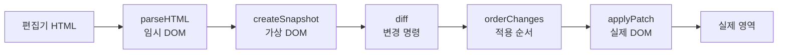

# Mini React

> 브라우저 DOM을 가상 DOM으로 만들고, 이전 스냅샷과 비교해 바뀐 부분만 실제 DOM에 반영하는 미니 리액트입니다.

<!-- Phase 1 초안입니다. Phase 2 항목은 구현·검증 후 채웁니다. -->
<!-- 발표 배분: 검증 대상 30초 → 검증 방법 60초 → 검증으로 드러난 것 70초 → 결과와 한계 60초 → 소개·마무리 20초 -->

## 1. 프로젝트 소개

Phase 1의 목표는 두 가지입니다.

1. 화면을 설명하는 데이터 트리(가상 DOM)를 만들고, 이전 트리와 비교해 **변경 명령을 계산한다.** (`diff`)
2. 계산된 명령만 실제 DOM에 적용하고, **나머지 노드는 그대로 재사용한다.** (`patch`)

따라서 Phase 1에서 검증해야 하는 대상은 편집기 화면이 아니라 **`diff`와 `patch`의 동작**입니다. 코드 편집기, Patch 버튼, 뒤로·앞으로 버튼은 이 두 함수를 실제 입력으로 확인하기 위한 하네스입니다.

| 단계 | 범위 | 상태 |
| --- | --- | --- |
| Phase 1 | 가상 DOM · `diff` · `patch` · 검증 하네스 | 구현·검증 완료 |
| Phase 2 | 함수형 컴포넌트 · 상태 · 훅 | 작성 예정 |

## 2. 검증 대상과 기준

"화면이 잘 보인다"가 아니라, **어떤 입력에서 어떤 명령이 나와야 하고 그 명령이 DOM을 어떻게 바꿔야 하는지**를 기준으로 검증했습니다.

| 검증 축 | 확인한 질문 | 테스트 ID |
| --- | --- | --- |
| 변경 계산 (`diff`) | 두 가상 DOM의 차이를 정확한 명령으로 표현하는가 | DIFF-01–09 |
| 명령 정렬 (`orderChanges`) | 부모·기준 형제가 준비된 순서인가, 무효 참조나 중복 명령이 없는가 | ORDER-01–05 |
| 이동 판단 | 삽입·삭제로 생긴 위치 변화를 이동으로 오인하지 않는가 | MOVE-01–07 |
| 실제 반영 (`patch`) | 명령대로만 DOM을 바꾸고, 유지 노드는 같은 객체를 재사용하는가 | PATCH-01–08 |
| 참조 연결 | Patch 후 다음 가상 DOM 전체가 실제 DOM을 가리키는가 | PATCH-08, IT-01–08 |
| 정책 경계 | 중복 `key`, `key` 변경, 입력·선택 상태를 어떻게 처리하는가 | DIFF-04–05, CONF-03 |

### 검증에 사용한 입력

가상 DOM은 손으로 만든 객체가 아니라 **실제 HTML을 파싱해 만든 스냅샷**을 사용했습니다.



## 3. 검증 방법

### 3.1 명세에서 테스트 ID를 먼저 정하고, 코드를 나중에 작성

- 요구사항과 명세에서 테스트 ID별 입력·검증 시점·기대 결과를 먼저 확정했습니다.
- 테스트를 먼저 작성하고 **실패 원인을 구분**했습니다.
  - 모듈이 없어 수집·호출 단계에서 중단된 경우
  - 기대 결과와 달라 assertion이 실패한 경우
- 구현 후 같은 테스트를 다시 실행해 통과를 확인했습니다. 기대 결과를 구현에 맞춰 바꾸지 않았습니다.

### 3.2 세 층으로 나눠 검증

| 층 | 대상 | 대체 범위 | 이유 |
| --- | --- | --- | --- |
| 단위 | 실제 `diff()`, `findChildMatches()` 등 | 없음 | 대응·명령 계산 자체를 확인 |
| 격리 | `collectChildChanges()`의 취합 책임 | 하위 3개 모듈만 가짜 결과 | 취합 로직만 따로 확인 |
| 통합 | `parseHTML → createSnapshot → diff → applyPatch` | 없음 | 실제 함수 연결에서 최종 DOM 확인 |

격리 테스트는 **취합 함수의 인자 전달·반환·오류 전달**만 확인합니다. 이 통과를 "diff 전체가 맞다"는 근거로 사용하지 않았습니다.

### 3.3 불변 조건을 함께 검증

명령 개수만 세면 "우연히 같은 화면"을 통과시킬 수 있습니다. 그래서 다음 조건을 매 테스트에서 함께 확인했습니다.

- `diff()`는 **입력 가상 DOM과 실제 DOM을 수정하지 않는다.**
- 명령은 데이터 복사본이 아니라 **`VNode` 객체 참조**를 담는다. (`toBe`로 동일성 확인)
- 명령이 없으면 빈 배열이고, Patch와 이력 저장을 생략한다.
- 유지 노드는 **같은 실제 DOM 객체**를 재사용한다.
- `patch` 종료 시 `assertAllLinked()`로 전체 참조 연결을 확인한다.

### 3.4 명령을 실제 DOM에 적용해 끝까지 확인

- `diff`가 명령을 반환했다는 사실만으로 끝내지 않고, `orderChanges`로 정렬한 뒤 `applyPatch`를 실행했습니다.
- 최종 DOM의 순서, 노드 객체 동일성, 삭제된 노드의 분리 여부를 확인했습니다.
- 명령을 배열 모형에 적용하는 데 그치지 않고 실제 DOM 연산으로 확인한 케이스를 구분해 기록했습니다.

## 4. 검증 과정에서 드러난 것

검증은 통과 여부만 알려주지 않았습니다. **설계를 바꿔야 하는 지점**을 드러냈습니다.

### 4.1 유지 노드 연결을 Patch에서 Diff로 옮김

- **발견:** 다음 가상 DOM은 매번 새 객체라, 변경 명령이 없는 노드는 Patch 대상에 없습니다. 그런데 Patch 후에는 다음 가상 DOM 전체가 실제 DOM을 가리켜야 다음 비교가 가능합니다.
- **1차 시도:** Patch가 매칭을 다시 실행해 연결.
- **문제:** 실행 경로와 테스트 경로에 매칭 구현이 중복됐고, 중복 `key` 처리 규칙이 서로 달라 **같은 입력에서 다른 대응이 나올 수 있었습니다.**
- **변경:** Diff가 비교에 쓴 대응 결과로 유지·이동·수정 노드를 연결하고, Patch는 삽입·교체 노드 생성과 DOM 변경만 담당.
- **효과:** 매칭 1회, `diff()` 반환 타입과 `applyPatch()` 시그니처 유지.

### 4.2 `key` 정책을 검증 중에 확정

| 경우 | 확정한 처리 |
| --- | --- |
| 같은 `key` + 같은 태그 | 유지하고 내부만 갱신 |
| 같은 `key` + 다른 태그 | 제자리 교체 |
| `key` 값 변경 | 제거 + 삽입 |
| 같은 부모의 중복 `key` | 그 비교에서 `key`를 식별자로 쓰지 않고 순서 대응 |

이 확정으로 기존에 `skip` 상태이던 태그 변경 케이스를 해소했고, `key` 변경 케이스의 기대 결과를 **교체 → 제거+삽입**으로 바로잡았습니다.

### 4.3 테스트 fixture 오류를 발견

- 초기 통합 테스트에서 `ul`의 `key`를 실제 영역 루트의 `key`로 읽고 있었습니다.
- **구현 기대 결과는 바꾸지 않고** 테스트 입력만 수정했습니다.

### 4.4 미뤄둔 연계 검증을 해소

- 명령 정렬 5개와 이동 연계 2개는 Patch 적용 후 결과를 확인해야 해서 `todo`로 남아 있었습니다.
- 실제 `diff` → `orderChanges` → `applyPatch`를 연결해 모두 실행 가능한 검증으로 바꿨습니다.

## 5. 검증 결과

### 5.1 자동 검증

- 실행: 2026-11-09, `npm run check`
- 결과: 테스트 파일 **22개**, 테스트 **193개 통과**, skip **0개**, todo **0개**
- 타입 검사와 빌드도 통과했습니다.

| 영역 | 검증 ID | 결과 |
| --- | --- | --- |
| 변경 계산 | DIFF-01–09 | 통과 |
| 명령 정렬 | ORDER-01–05 | 통과 |
| 이동 | MOVE-01–07 | 통과 |
| 실제 반영 | PATCH-01–08 | 통과 |
| 전체 흐름 | FLOW-01–05 | 통과 |
| 통합 | IT-01–08 | 통과 |
| 정책 경계 | CONF-03 | 통과 |

### 5.2 하네스로 확인한 실제 동작

- 편집기 수정 → Patch → 바뀐 부분만 반영
- 뒤로·앞으로 → 화면과 HTML 원문 함께 복원
- 복원 후 연속 Patch → 새로 만든 DOM을 다음 비교 기준으로 사용
- 폼의 값·체크·선택 상태 유지
- 페이지 오류 0건, 콘솔 오류 0건 (favicon 404 제외)

### 5.3 검증하지 못한 것

- **최소 이동 횟수는 회귀 테스트로 고정하지 않았습니다.** 형제 6개의 720개 순열을 최단 이동과 비교한 것은 일회성 확인입니다.
- **성능을 측정하지 않았습니다.** 계산 비용과 Patch 비용 중 어느 쪽이 지배적인지 확인하지 않았습니다.
- **브라우저 자동화가 없습니다.** 실제 화면 동작은 수동으로 확인했습니다.
- **복원 실패 정책이 미확정입니다.** Patch 실패 시 복구는 검증했지만, 복구 자체가 실패할 때의 오류 표시·재시작 정책은 정하지 않았습니다.

### 5.4 실제 React와의 차이

- React는 컴포넌트 트리를 기준으로 조정하지만, 여기서는 **HTML을 매번 파싱**해 가상 DOM을 만듭니다.
- Fiber, 우선순위 스케줄링, 동시성 기능이 없습니다. Patch는 동기적으로 한 번에 적용합니다.
- `key`를 실제 DOM에도 렌더링합니다. React는 `key`를 DOM에 전달하지 않습니다.
- 컴포넌트·상태·훅 계층은 아직 없습니다. Phase 2에서 추가합니다.

## 6. 실행 방법

```bash
npm install
npm run dev
```

- 개발 서버: `http://localhost:5173/main.html`
- 테스트: `npm test`
- 타입 검사 포함 전체 검증: `npm run check`
- 빌드: `npm run build`

## 7. 팀원과 역할

[작성 예정]
