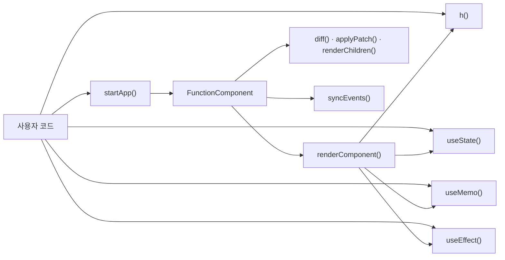
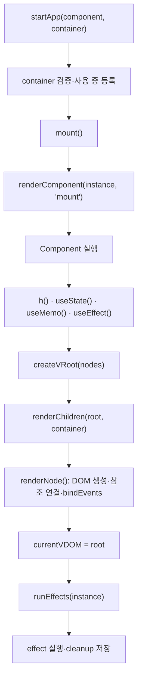
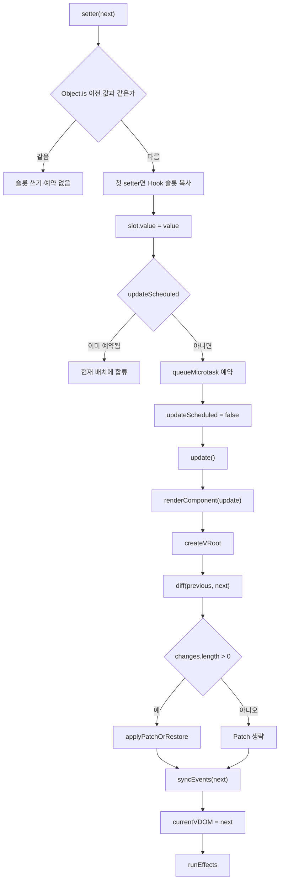
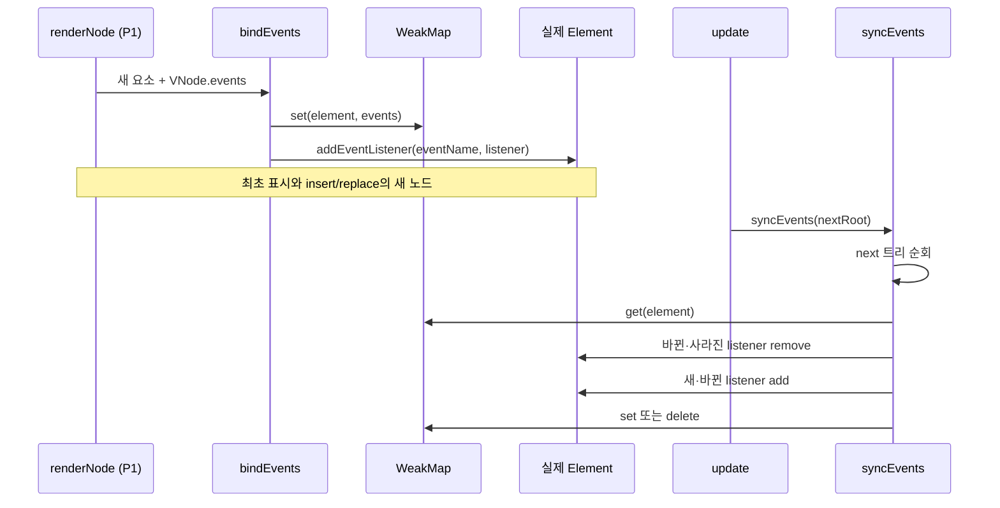
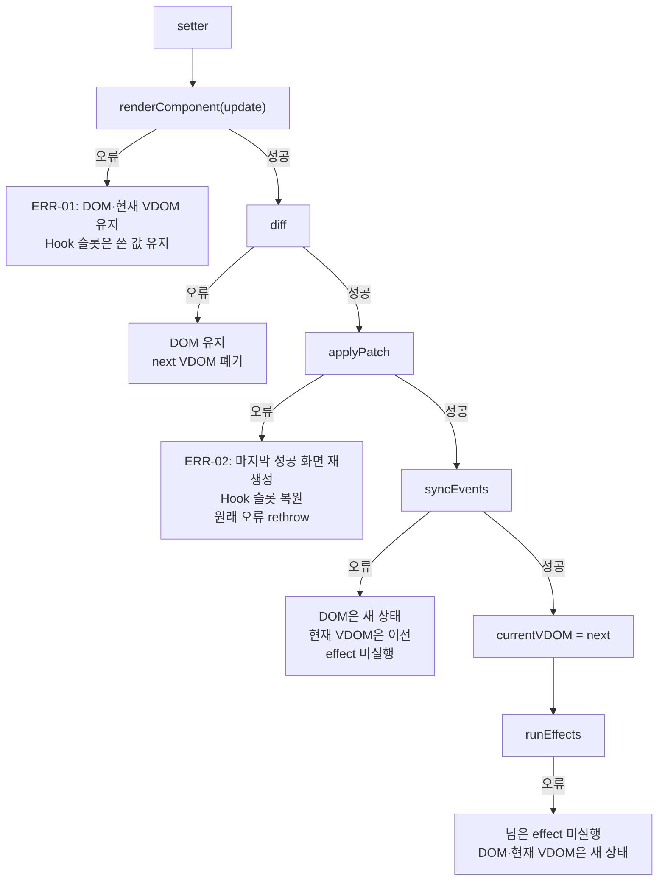

# Phase 2 함수 흐름 — Top down

기준: [resc/phase2.md](../resc/phase2.md), [p2_test_cases.md](p2_test_cases.md), [p2_decisions.md](p2_decisions.md), [wiki/Phase2-Design-merged.md](../wiki/Phase2-Design-merged.md)의 승인안.
이 문서는 구현 호출 구조를 위에서 아래로 설명한다. 함수 이름과 책임은 승인안에서 고정한 이름을 따르고, 나머지 helper는 구현 모듈 내부 이름이다. 코드를 보지 않아도 "누가 무엇을 언제 호출하는가"를 따라갈 수 있게 쓰는 것이 목적이다.

표기:

- **[공개]** 사용자 코드가 직접 호출하는 경계다.
- **[내부]** 공개 경계 안에서만 호출한다. 테스트가 직접 호출하지 않는다.
- **[P1]** Phase 1의 Diff·Patch·렌더링 함수를 그대로 재사용한다.

## 1. 공개 경계와 전체 호출 지도

공개 경계는 `src/component/index.ts` 하나다. `FunctionComponent`, `mount()`, `update()`는 공개하지 않는다.

| 함수 | 입력 | 출력 | 역할 | 호출 시점 |
| --- | --- | --- | --- | --- |
| `h(tagName, props, ...children)` | 태그 이름, props 객체(선택), 자식 값들 | 요소 `VNode` | props 분류, children 정규화, 문자열·숫자를 Text VNode로 변환 | Component render 안, 또는 정적 VNode를 만들 때 |
| `startApp(component, container)` | 최상위 Component 함수, 표시할 `Element` | `void` | container 검증·1회 등록, 루트 `FunctionComponent` 준비, `mount()` 호출 | 앱 시작 1회 |
| `useState(initialValue)` | 초기값 | `[현재 값, setter]` | 호출 순서 위치의 State 슬롯 조회·생성, 안정된 setter 반환 | Component 실행 중 |
| `useMemo(calculate, deps)` | 계산 함수, 의존성 배열(필수) | 계산 결과 | deps가 같으면 캐시 재사용, 다르면 재계산 | Component 실행 중 |
| `useEffect(effect, deps?)` | 효과 함수, 의존성 배열(선택) | `void` | render 중 실행 후보 등록, commit 뒤 cleanup·effect 실행 | Component 실행 중 |



## 2. 최초 표시 흐름

`startApp()`은 container를 검증하고 사용 중으로 등록한 뒤, 루트 `FunctionComponent`를 만들어 `mount()`를 호출한다. `mount()`는 Component를 한 번 실행해 VNode 목록을 만들고, VRoot로 감싼 뒤 실제 DOM을 생성한다. 성공한 VDOM만 현재 비교 기준이 되고, 마지막에 effect를 실행한다.

```text
startApp(component, container)
├─ assertStartContainer(container)          Element 검사·중복 시작 검사
├─ startedContainers.add(container)         첫 렌더 전에 사용 중 등록
└─ new FunctionComponent(component, container).mount()
   ├─ renderComponent(instance, 'mount')
   │  ├─ beginHooks(instance, 'mount')      activeHookOwner 설정, cursor=0
   │  ├─ instance.component()               사용자 Component 실행
   │  │  ├─ useState()  → claimHookSlot('state')  → 슬롯 생성
   │  │  ├─ useMemo()   → claimHookSlot('memo')   → 첫 계산
   │  │  └─ useEffect() → claimHookSlot('effect') → 실행 후보 등록
   │  ├─ assertHookCountConsumed()          mount에서는 검사하지 않음
   │  ├─ normalizeComponentResult()         반환값을 VNode[]로 정규화
   │  └─ endHooks()                         finally에서 문맥 해제
   ├─ createVRoot(nodes)                    { childNodes, dom: null }
   ├─ renderChildren(root, container)       [P1] 기존 자식 제거·전체 DOM 생성
   │  ├─ container.replaceChildren()
   │  ├─ root.dom = container
   │  └─ child마다 renderNode(child)        [P1] DOM 생성·참조 연결·bindEvents
   ├─ currentVDOM = root                    성공한 렌더만 비교 기준
   └─ runEffects(instance)                  effect 슬롯을 순서대로 실행
      ├─ runEffectCleanup(slot)             mount에는 cleanup이 없음
      ├─ invokeEffect(slot.effect)          effect 실행·cleanup 반환 검사
      └─ slot.cleanup·deps·shouldRun 갱신   성공한 실행만 다음 기준이 됨
```



핵심 계약:

- Component 실행과 반환값 검증이 끝난 뒤에야 `renderChildren()`을 호출한다. Component나 `h()`가 던지면 컨테이너는 건드리지 않는다.
- `renderChildren()`은 컨테이너의 기존 자식을 모두 제거하고 VRoot의 자식들을 새로 만든다. 최초 표시에서는 비교할 이전 VDOM이 없으므로 전체 생성이 맞다.
- `renderNode()`는 요소를 만들면서 `vnode.dom`을 연결하고, attributes → childNodes → properties 순서로 적용한 뒤 `events`가 있으면 `bindEvents()`를 호출한다.
- `currentVDOM`은 `renderChildren()` 성공 뒤에 지정한다. 실패한 최초 렌더는 비교 기준을 남기지 않는다.
- effect는 DOM 생성과 `currentVDOM` 지정이 모두 끝난 뒤 실행한다. 그래서 effect 안에서 컨테이너의 DOM을 조회할 수 있다(INIT-03).

## 3. 갱신 흐름

setter는 값을 바꾸고 갱신을 예약한다. 실제 재렌더는 현재 동기 처리(클릭 handler·effect)가 끝난 뒤 microtask에서 한 번 실행된다. `update()`는 새 VDOM을 만들고, Diff로 변경 명령을 계산하고, 필요한 Patch·이벤트 동기화를 수행한 뒤 현재 VDOM을 교체하고 effect를 실행한다.

```text
setter(next)
├─ applyStateUpdate(instance, slot, next)
│  ├─ 함수형 updater면 previous 값을 기준으로 계산
│  ├─ Object.is(previous, value) → 같으면 슬롯도 쓰지 않고 종료
│  ├─ rememberHooksBeforeUpdate()          첫 setter만 슬롯 얕은 복사
│  ├─ slot.value = value
│  └─ scheduleUpdate(instance)
│     ├─ updateScheduled가 true면 종료
│     ├─ updateScheduled = true
│     └─ queueMicrotask(callback)
│        ├─ updateScheduled = false
│        └─ update()
│           ├─ previousRoot = currentVDOM  null이면 오류
│           ├─ try
│           │  ├─ renderComponent(instance, 'update')
│           │  │  ├─ beginHooks()          cursor=0, phase=update
│           │  │  ├─ instance.component()
│           │  │  ├─ assertHookCountConsumed()  개수 감소 검사
│           │  │  ├─ normalizeComponentResult()
│           │  │  └─ endHooks()            finally
│           │  ├─ createVRoot(nodes)
│           │  ├─ diff(previousRoot, nextRoot)          [P1] 명령 계산·유지 노드 연결
│           │  ├─ changes.length > 0이면
│           │  │  └─ applyPatchOrRestore()
│           │  │     ├─ applyPatch(previousRoot, nextRoot, changes)  [P1]
│           │  │     └─ catch → restorePatchFailure() → 원래 오류 rethrow
│           │  ├─ syncEvents(nextRoot)     화면 데이터와 무관하게 항상
│           │  └─ currentVDOM = nextRoot
│           ├─ finally
│           │  └─ discardHooksBeforeUpdate()
│           └─ runEffects(instance)        try가 정상 종료된 경우에만
```



핵심 계약:

- **배치**: 같은 동기 처리에서 setter를 여러 번 호출해도 예약은 1회다. 예약 콜백이 시작되면서 플래그를 내리므로, effect 안 setter는 현재 처리 뒤의 다음 microtask로 이어진다(UPD-05·06).
- **화면이 같아도 하는 일**: `diff()`가 빈 배열을 반환하면 `applyPatch()`는 생략하지만 `syncEvents()`·`currentVDOM` 교체·`runEffects()`는 수행한다. 그래야 handler만 바뀐 갱신(UPD-03)과 deps만 바뀐 효과(EFF-01)가 반영된다.
- **현재 VDOM**: `syncEvents()`까지 성공한 뒤에만 `nextRoot`로 교체한다. Diff나 Patch가 실패한 갱신은 마지막 성공 VDOM을 덮어쓰지 않는다.
- **Hook 복사본**: `rememberHooksBeforeUpdate()`는 첫 변경 setter가 값을 쓰기 전에 슬롯 필드를 얕은 복사한다. 성공·실패와 무관하게 `update()`의 `finally`에서 복사본을 버린다. Patch 실패만 예외적으로 복사본으로 필드를 되돌린다(P2-FAIL-02).
- **effect 시점**: `runEffects()`는 `finally` 밖에서 호출한다. effect가 setter를 호출하면 이미 복사본이 버려진 뒤이므로 새 배치의 시작 상태를 새로 복사한다.

## 4. h() 흐름

`h()`는 태그를 정규화하고, props를 이벤트·property·attribute로 나누고, children을 VNode 목록으로 정리해 요소 VNode 하나를 만든다. DOM은 만들지 않는다.

```text
h(tagName, props, ...children)
├─ normalizeTagName(tagName)
│  ├─ 문자열 검사
│  ├─ trim
│  ├─ 빈 문자열 검사
│  └─ toUpperCase()
├─ classifyProps(tagName, props)
│  └─ Object.entries(props ?? {}) 각각
│     ├─ isEventProp(name)                  이름이 "on"으로 시작
│     │  └─ addEvent()
│     ├─ isPropertyProp(tagName, name)      propertySchema[tagName]에 포함
│     │  └─ properties[name] = value        값 무변환
│     └─ 그 밖
│        └─ addAttribute(normalizeAttributeName(name), value)
├─ normalizeChildren(children)
│  └─ appendChild() 재귀
│     ├─ null·undefined·boolean → 제외
│     ├─ 배열 → 재귀 펼침
│     ├─ 문자열·숫자 → appendTextChild() → createTextVNode()
│     ├─ VNode → 그대로 유지
│     └─ 그 밖 → 오류
├─ 요소 VNode 생성                          { nodeType: 1, dom: null, ... }
└─ events가 비어 있지 않을 때만 node.events = events
```

props 분류 결과:

| 순서 | 판정 | 저장 위치 | 규칙 |
| --- | --- | --- | --- |
| 1 | 이름이 `on`으로 시작 | `events[DOM 이벤트 이름]` | `onClick`→`click`, `onInput`→`input`, `onChange`→`change`만 지원. `null`·`undefined`는 생략, 함수가 아니면 오류, 지원 밖 이름은 오류 |
| 2 | `propertySchema[tagName]`에 포함 | `properties[name]` | 값 타입을 바꾸지 않는다. `INPUT`의 `value`·`checked`·`indeterminate`, `TEXTAREA`·`SELECT`의 `value`, `OPTION`의 `selected` |
| 3 | 그 밖 | `attributes[]` | `className`→`class`. `null`·`undefined`·`false` 생략, `true`→`""`, 객체는 오류, 그 밖은 `String(value)` |

children 규칙:

| 입력 | 결과 |
| --- | --- |
| `VNode` | 그대로 자식 목록에 추가 |
| 배열 | 재귀적으로 펼침. 빈 배열은 빈 목록이며 오류가 아니다 |
| 문자열 | Text VNode로 변환. 빈 문자열은 노드를 만들지 않는다 |
| 숫자 | `String(value)` Text VNode로 변환 |
| `null`·`undefined`·boolean | 목록에서 제외 |
| 객체·함수·DOM Node·Promise 등 | 오류 |

Component 반환값은 `h()`의 children과 구조 정리 규칙을 공유하지만, 원시 문자열·숫자를 Text VNode로 바꾸지 않고 오류로 처리한다. 텍스트는 `h()`에서만 만든다.

## 5. 이벤트 연결과 동기화

이벤트는 요소별 직접 연결이다. 루트 위임을 쓰지 않는다. 최초 연결과 갱신을 분리해, 화면 데이터가 같아도 handler 교체·제거를 반영한다.

```text
renderNode(element)                          [P1]
└─ vnode.events가 있으면
   └─ bindEvents(element, events)
      ├─ nodeEvents.set(element, events)     WeakMap 기록
      └─ eventName마다 element.addEventListener(eventName, listener)

update()
└─ syncEvents(nextRoot)
   └─ nextRoot.childNodes 순회
      └─ syncNodeEvents(node)
         ├─ 요소 VNode면 syncElementEvents(node)
         │  ├─ node.dom === null → 오류
         │  ├─ node.dom이 Element가 아니면 → 오류
         │  └─ replaceNodeEvents(node.dom, node.events ?? {})
         │     ├─ 이전 기록과 다음 map 비교
         │     ├─ 바뀐·사라진 listener → removeEventListener
         │     ├─ 새·바뀐 listener → addEventListener
         │     └─ 다음 map이 비면 기록 삭제, 아니면 새 map 기록
         └─ 자식 VNode 재귀
```



핵심 계약:

- **비교 기준은 VNode가 아니라 실제 노드의 WeakMap 기록**이다. VNode는 갱신마다 새로 만들어지므로 VNode의 이전 `events`를 비교하면 안 된다.
- 새로 만든 노드는 `renderNode()`가 이미 `bindEvents()`로 기록했으므로 `syncEvents()`의 비교 결과가 같음이 된다. 중복 연결이 생기지 않는다.
- `syncEvents()`는 `diff()`가 유지 노드의 `dom`을 연결한 뒤에 호출한다. 그래야 유지 노드의 실제 DOM을 찾을 수 있다.
- 요소가 사라지면 WeakMap 항목은 GC 대상이 된다. 별도 해제 순회를 두지 않는다.

## 6. 실패 경계

실패 지점마다 "실제 DOM이 바뀌었는가", "Hook 슬롯과 현재 VDOM이 어느 시점인가", "호출자에게 무엇이 전파되는가"가 다르다. 아래 표는 `src/component/index.ts`의 현재 구현 순서를 기준으로 한다.

| 단계 | 실패 지점 | 실제 DOM | Hook 슬롯·현재 VDOM | 전파·후속 |
| --- | --- | --- | --- | --- |
| `startApp` 인자 검증 | container가 `Element`가 아님, 이미 시작한 container | 변경 없음 | 인스턴스 없음 / 기존 앱 유지 | 오류 전파. 새 앱을 만들지 않는다 |
| `mount()`의 `renderComponent` | Component 실행, `h()`, Hook 호출, 반환값 정규화 | 변경 없음(`renderChildren` 이전) | 새 인스턴스의 슬롯이 일부 만들어질 수 있음. `currentVDOM`은 null | 오류 전파. container는 사용 중으로 남아 재시작할 수 없다 |
| `mount()`의 `renderChildren` | 최초 DOM 생성 중 오류 | 기존 자식은 이미 제거되고 새 자식이 붙지 않을 수 있음 | `currentVDOM`은 null, effect 없음 | 오류 전파. 복원할 이전 VDOM이 없다 |
| `update()`의 `renderComponent` | Component 실행, `h()`, Hook 호출, 반환값 정규화 | 마지막 성공 화면 유지 | setter가 쓴 State와 render가 쓴 Hook 기록은 유지. `currentVDOM`은 이전 | 오류 전파. 다음 setter는 새 갱신을 예약할 수 있다 |
| `update()`의 `diff` | 변경 명령 계산·연결 중 오류 | 마지막 성공 화면 유지 | Hook 기록은 유지. `currentVDOM`은 이전 | 오류 전파. 부분 연결된 next VDOM은 폐기된다 |
| `update()`의 `applyPatch` | 실제 DOM 명령 적용 중 오류 | 중간까지 바뀔 수 있음 | **화면과 훅 슬롯을 갱신 시작 전으로 원자적 복원**. `currentVDOM`은 이전 | 원래 오류 rethrow. `syncEvents`·effect 미실행. 다음 갱신은 복구된 화면 기준 |
| `update()`의 `syncEvents` | handler 동기화 중 오류 | Patch가 끝났으므로 새 화면 | 훅 복사본은 복원 없이 버려짐. `currentVDOM`은 이전 | 오류 전파. effect 미실행. 이후 일관성은 보장하지 않는다 |
| `runEffects()`의 cleanup·effect | cleanup 또는 effect 실행 중 오류 | 이미 commit된 새 화면 | `currentVDOM`은 새 상태. 실행 성공 전 effect의 `deps`·`shouldRun`은 갱신되지 않음 | 오류 전파. 남은 effect는 실행하지 않는다. cleanup 슬롯은 호출 전에 비워 재실행하지 않는다 |

### ERR-01과 ERR-02의 차이

| 구분 | ERR-01 — render 오류 | ERR-02 — applyPatch 실패 |
| --- | --- | --- |
| 실패 지점 | `update()`의 Component 실행·정규화 | `update()`의 실제 DOM 명령 적용 |
| 실제 DOM | 건드리지 않음 | 중간까지 바뀔 수 있음 |
| State·Hook 슬롯 | **복원하지 않는다.** setter가 쓴 값이 유지된다 | **갱신 시작 전으로 복원한다.** 화면과 같은 시점을 가리킨다 |
| 현재 VDOM | 마지막 성공 VDOM | 마지막 성공 VDOM |
| `syncEvents`·effect | 실행하지 않음 | 실행하지 않음 |
| 다음 갱신 | 실패한 클릭의 State 증가가 남아 이어진다 | 같은 setter를 다시 호출하면 복구된 State에서 새 변경으로 예약된다 |



복원의 세부 순서:

```text
applyPatch 실패
├─ restoreLastCommittedRoot(instance, previousRoot)
│  └─ renderChildren(previousRoot, container)   마지막 성공 화면 재생성·dom 재연결
│     └─ 복원 중 오류는 삼킨다                  원래 Patch 오류를 가리지 않는다
├─ restoreHooksBeforeUpdate()
│  └─ Object.assign(slot, snapshot[index])      슬롯 객체·배열 동일성 유지
├─ updateScheduled = false                      다음 setter가 새 갱신을 예약
└─ throw originalError                          원래 오류 전파
```

복원은 얕은 복사다. State 값 객체를 제자리에서 변경하는 사용은 지원하지 않는다. 복원은 전체 재생성이므로 포커스·스크롤·비제어 입력 상태는 보존하지 않는다.

## 7. 함수별 표

### 7.1 공개 경계

| 이름 | 경계 | 입력 | 출력 | 역할 | 호출 시점 |
| --- | --- | --- | --- | --- | --- |
| `h` | 공개 | `tagName: string`, `props?: Record<string, unknown> \| null`, `...children: unknown[]` | `VNode` | 태그·props·children 정규화, Text VNode 변환 | Component render, 정적 VNode 생성 |
| `startApp` | 공개 | `component: () => unknown`, `container: Element` | `void` | container 검증·등록, `FunctionComponent.mount()` | 앱 시작 1회 |
| `useState` | 공개 | `initialValue: T` | `[T, setter]` | State 슬롯 조회·생성, 안정된 setter | Component 실행 중 |
| `useMemo` | 공개 | `calculate: () => T`, `deps: readonly unknown[]` | `T` | deps 비교 후 캐시 또는 재계산 | Component 실행 중 |
| `useEffect` | 공개 | `effect: () => void \| (() => void)`, `deps?: readonly unknown[]` | `void` | 실행 후보 등록, commit 뒤 실행 | Component 실행 중 |

### 7.2 진입·생명주기 내부

| 이름 | 경계 | 입력 | 출력 | 역할 | 호출 시점 |
| --- | --- | --- | --- | --- | --- |
| `FunctionComponent` | 내부 | `component`, `container` | 인스턴스 | `hooks`·`cursor`·`phase`·`currentVDOM`·`hooksBeforeUpdate` 보관 | `startApp` |
| `mount` | 내부 | 없음 | `void` | 최초 render·DOM 생성·현재 VDOM 지정·effect 실행 | `startApp` |
| `update` | 내부 | 없음 | `void` | 재렌더·Diff·Patch·이벤트 동기화·현재 VDOM 교체·effect 실행 | 예약 콜백 |
| `applyPatchOrRestore` | 내부 | `instance`, `previousRoot`, `nextRoot`, `changes` | `void` | `applyPatch` 실행, 실패 시 복원 경계 호출 | `update`에서 변경 명령이 있을 때 |
| `restorePatchFailure` | 내부 | `instance`, `previousRoot` | `void` | 화면·훅 슬롯 복원, 예약 플래그 해제 | `applyPatch` catch |
| `restoreLastCommittedRoot` | 내부 | `instance`, `previousRoot` | `void` | 마지막 성공 VDOM으로 컨테이너 재생성, 복원 오류 무시 | `restorePatchFailure` |
| `renderComponent` | 내부 | `instance`, `phase` | `VNode[]` | Hook 문맥 설정·Component 실행·개수 검사·반환값 정규화 | `mount`·`update` |
| `createVRoot` | 내부 | `nodes: VNode[]` | `VRoot` | `dom: null`인 비교 루트 생성 | `renderComponent` 직후 |
| `normalizeComponentResult` | 내부 | `value: unknown` | `VNode[]` | 배열 펼침·빈 값 제외·VNode 검사 | `renderComponent` |
| `scheduleUpdate` | 내부 | `instance` | `void` | 인스턴스별 1회 microtask 예약 | 변경된 setter |
| `runEffects` | 내부 | `instance` | `void` | effect 슬롯을 호출 순서대로 실행 | `mount`·`update`의 commit 뒤 |
| `createTextVNode` | 내부 | `nodeValue: string` | `VNode` | `nodeType: 3`, `tagName: null` 텍스트 VNode | `h()`의 텍스트 자식 |

### 7.3 Hook 내부

| 이름 | 경계 | 입력 | 출력 | 역할 | 호출 시점 |
| --- | --- | --- | --- | --- | --- |
| `beginHooks` | 내부 | `instance`, `phase` | `void` | 소유자 설정, `cursor=0`, phase 기록 | 모든 render 시작 |
| `endHooks` | 내부 | 없음 | `void` | `activeHookOwner` 해제 | `renderComponent`의 `finally` |
| `requireHookOwner` | 내부 | `hookName` | `FunctionComponent` | 컴포넌트 실행 밖 Hook 호출 차단 | 모든 Hook 진입 |
| `claimHookSlot` | 내부 | `instance`, `kind`, `create` | `HookSlot` | cursor 위치 슬롯 조회·mount 생성·종류 검사 | 모든 Hook |
| `assertHookCountConsumed` | 내부 | `instance`, `phase` | `void` | update에서 Hook 개수 감소 검사 | `renderComponent` |
| `createStateHookSlot` | 내부 | `instance`, `initialValue` | `StateHookSlot` | 값·자기 슬롯을 기억하는 setter 생성 | mount의 `useState` |
| `applyStateUpdate` | 내부 | `instance`, `slot`, `next` | `void` | updater 계산·`Object.is` 비교·값 쓰기·예약 | setter 호출 |
| `copyHookSlot` | 내부 | `slot` | `HookSlot` | 슬롯 필드 얕은 복사 | `rememberHooksBeforeUpdate` |
| `rememberHooksBeforeUpdate` | 내부 | 없음(인스턴스 메서드) | `void` | 첫 setter에서 갱신 시작 전 슬롯 복사 | `applyStateUpdate` |
| `restoreHooksBeforeUpdate` | 내부 | 없음(인스턴스 메서드) | `void` | 슬롯 필드를 복사본으로 되돌림 | `restorePatchFailure` |
| `discardHooksBeforeUpdate` | 내부 | 없음(인스턴스 메서드) | `void` | 복사본 폐기 | `update`의 `finally`·복원 |
| `assertMemoDependencies` | 내부 | `deps: unknown` | `readonly unknown[]` | 배열 검사 | `useMemo` |
| `areHookDepsEqual` | 내부 | `previous`, `next` | `boolean` | 길이·`Object.is` 비교 | `useMemo`·`shouldRunEffect` |
| `createMemoHookSlot` | 내부 | `calculate`, `deps` | `MemoHookSlot` | 첫 계산 후 기록 생성 | mount의 `useMemo` |
| `updateMemoHookSlot` | 내부 | `slot`, `calculate`, `deps` | `T` | 계산 성공 후 value·deps 갱신 | update의 `useMemo` |
| `assertEffectDependencies` | 내부 | `deps: unknown` | `readonly unknown[] \| undefined` | 생략·배열 검사 | `useEffect` |
| `createEffectHookSlot` | 내부 | `effect`, `deps` | `EffectHookSlot` | 첫 실행 후보 기록 | mount의 `useEffect` |
| `registerEffectForCommit` | 내부 | `slot`, `effect`, `nextDeps` | `void` | 이번 render 후보·실행 여부 등록 | update의 `useEffect` |
| `shouldRunEffect` | 내부 | `slot`, `nextDeps` | `boolean` | 생략·기준 없음·deps 비교 | `registerEffectForCommit` |
| `runEffectSlot` | 내부 | `slot` | `void` | cleanup → effect 실행 → 성공 후 기준 갱신 | `runEffects` |
| `runEffectCleanup` | 내부 | `slot` | `void` | 슬롯을 비운 뒤 cleanup 호출 | `runEffectSlot` |
| `invokeEffect` | 내부 | `effect` | `() => void \| null` | effect 실행·반환값 검사 | `runEffectSlot` |

### 7.4 h()·정규화 내부

| 이름 | 경계 | 입력 | 출력 | 역할 | 호출 시점 |
| --- | --- | --- | --- | --- | --- |
| `normalizeTagName` | 내부 | `value: unknown` | `string` | 문자열 검사·trim·빈 값 검사·대문자화 | `h` |
| `classifyProps` | 내부 | `tagName`, `props` | `{ attributes, properties, events }` | props 전체 분류 | `h` |
| `classifyProp` | 내부 | `classified`, `tagName`, `name`, `value` | `void` | 이벤트 → property → attribute 순 판정 | `classifyProps` |
| `isEventProp` | 내부 | `name` | `boolean` | `on` 접두사 검사 | `classifyProp` |
| `isPropertyProp` | 내부 | `tagName`, `name` | `boolean` | `propertySchema` 포함 검사 | `classifyProp` |
| `normalizeAttributeName` | 내부 | `name` | `string` | `className`→`class` | `classifyProp` |
| `addAttribute` | 내부 | `attributes`, `name`, `value` | `void` | 생략·boolean·객체 오류·문자열 변환 | `classifyProp` |
| `addEvent` | 내부 | `events`, `propName`, `value` | `void` | 이벤트 이름 변환·값 검사·원본 함수 저장 | `classifyProp` |
| `normalizeChildren` | 내부 | `values: unknown[]` | `VNode[]` | 자식 목록 정규화 | `h` |
| `appendChild` | 내부 | `nodes`, `value` | `void` | 재귀 펼침·Text 변환·허용값 검사 | `normalizeChildren` |
| `isIgnoredChild` | 내부 | `value` | `boolean` | `null`·`undefined`·boolean 판정 | `h`·Component 정규화 |
| `appendTextChild` | 내부 | `nodes`, `text` | `void` | 빈 문자열 제외 후 Text VNode 추가 | `appendChild` |
| `isVNode` | 내부 | `value` | `value is VNode` | `nodeType`·`childNodes` 모양 검사 | children·Component 정규화 |

### 7.5 이벤트 내부

| 이름 | 경계 | 입력 | 출력 | 역할 | 호출 시점 |
| --- | --- | --- | --- | --- | --- |
| `bindEvents` | 모듈 경계 | `element`, `events` | `void` | WeakMap 기록 + 최초 listener 연결 | `renderNode` |
| `getNodeEvents` | 모듈 경계 | `node` | `VNodeEventMap \| undefined` | 기록 조회 | 현재 제품 경로에서 호출 없음 |
| `syncEvents` | 모듈 경계 | `root: VRoot` | `void` | next 트리의 handler 연결을 기록과 맞춤 | `update`의 Patch 뒤 |
| `syncNodeEvents` | 내부 | `node: VNode` | `void` | 요소면 동기화, 자식 재귀 | `syncEvents` |
| `syncElementEvents` | 내부 | `node: VNode` | `void` | `dom` 연결 검사 후 요소 동기화 | `syncNodeEvents` |
| `replaceNodeEvents` | 내부 | `element`, `nextEvents` | `void` | 이전 기록과 비교해 add/remove, 빈 map이면 기록 삭제 | `syncElementEvents` |

### 7.6 Phase 1 재사용

| 이름 | 경계 | 입력 | 출력 | 역할 | 호출 시점 |
| --- | --- | --- | --- | --- | --- |
| `renderChildren` | P1 | `root: VRoot`, `container` | `void` | 컨테이너 교체·전체 DOM 생성·루트 연결 | `mount`·복원 |
| `renderNode` | P1 | `vnode: VNode` | `Node` | DOM 생성·참조 연결·속성·properties·이벤트 연결 | `renderChildren`·Patch |
| `diff` | P1 | `previousRoot`, `nextRoot` | `DiffCommand[]` | 변경 명령 계산·유지 노드 `dom` 연결 | `update` |
| `applyPatch` | P1 | `previousRoot`, `nextRoot`, `changes` | `VRoot` | 실제 DOM 변경·새 노드 연결·전체 연결 검증 | `applyPatchOrRestore` |

## 8. 테스트 연결

| 흐름 | 테스트 ID | 테스트 파일 |
| --- | --- | --- |
| 최초 표시·container 경계 | INIT-01–INIT-04 | `tests/integration/p2/app.test.ts` |
| `h()`·정규화 | H-01–H-08 | `tests/unit/p2/h.test.ts` |
| Hook 슬롯·State·Memo | HOOK-01–HOOK-05, HOOK-07–HOOK-09 | `tests/unit/p2/hooks.test.ts` |
| Effect·cleanup | HOOK-06, EFF-01 | `tests/unit/p2/hooks.test.ts` |
| 갱신·이벤트 동기화 | UPD-01–UPD-06 | `tests/integration/p2/app.test.ts` |
| 실패 경계 | ERR-01·ERR-02 | `tests/integration/p2/errors.test.ts` |
| 사용자 흐름 | FLOW-01–FLOW-03 | `tests/integration/p2/app.test.ts` |

테스트 명세 ID는 33개이고, 같은 ID를 여러 입력·시나리오로 나눈 실행 단위와 명세 밖 보강 테스트를 포함한 실제 실행 단위는 75개다. 실행 결과와 파일별 수치는 [p2_test_boards.md](p2_test_boards.md)를 따른다.
